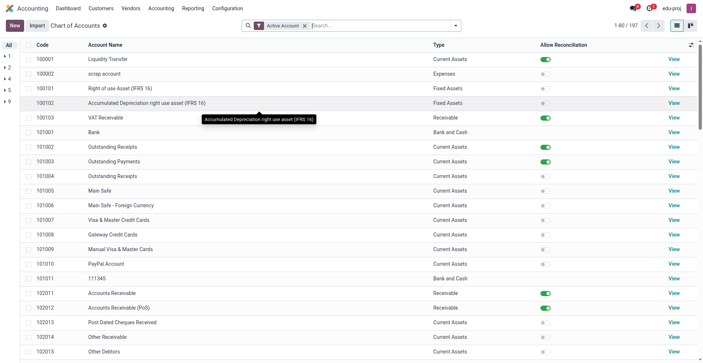
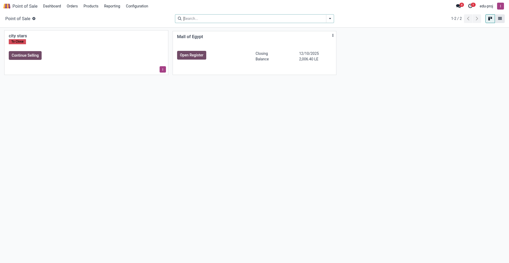
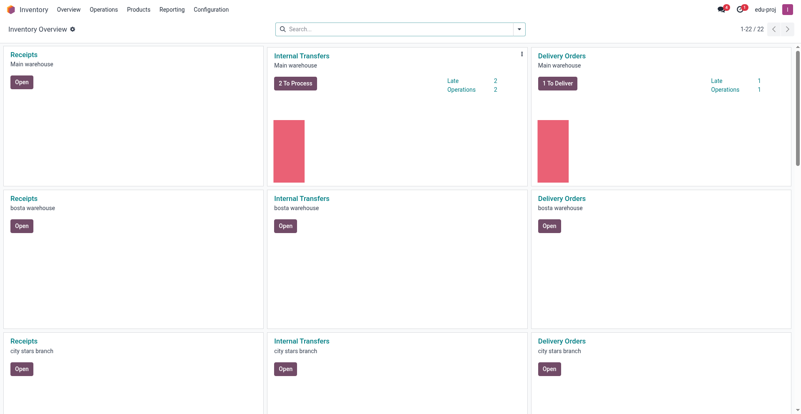
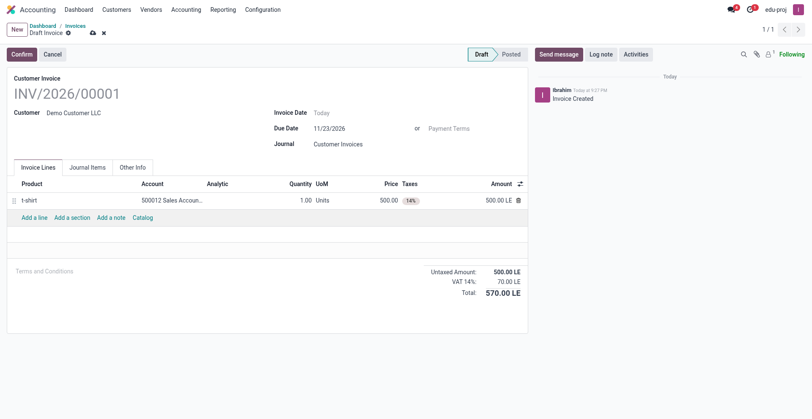

# Odoo Implementation for a Trading Company (DEPI Graduation Project)

> مشروع تخرج من برنامج DEPI: خطة تطبيق متكاملة لنظام Odoo في شركة تجارة ملابس، تشمل تحليل المتطلبات، واختيار الوحدات، وخطة تنفيذ على ٨ أسابيع، مع نسخة Odoo مُعدّة فعلياً كعرض تجريبي. قاد الفريق Ibrahim Mokhtar: وزّع المهام على أعضاء الفريق وتابع التنفيذ، وهو من نفّذ موديل الحسابات بنفسه (شجرة الحسابات والإعدادات المالية).

## About This Project

This is the graduation project of a team in Egypt's DEPI (Digital Egypt Pioneers Initiative) program. It covers the full functional side of an Odoo ERP implementation for a small clothing trading company: from business analysis to a configured demo instance and a go-live plan.

The project is a learning deliverable, presented honestly as such. It reflects the same working method we would apply with a real SME client.

**Live demo instance:** https://edu-proj1.odoo.com/

## Business Scenario

A clothing retail and trading SME with physical stores and warehouses, facing typical growth problems:

- Difficulty tracking inventory levels and transfers between branches
- Manual order management and slow sales cycles
- Accounting and invoicing handled outside any integrated system

The goal: one integrated Odoo setup covering sales, stock, point of sale, purchasing, and accounting.

## Modules Covered

| Module | Scope |
| --- | --- |
| Sales | Order management and customer relationships |
| Inventory | Stock levels, transfers between branches and warehouses |
| Point of Sale (PoS) | In-store sales operations |
| Accounting | Financial management, invoicing, chart of accounts |
| Purchases | Supplier management and procurement flow |

## Methodology

1. **System analysis** - document the company's current processes and pain points
2. **System design** - define functional requirements and the target process in Odoo
3. **Gap analysis** - identify what needs customization versus standard configuration
4. **Implementation planning** - phased rollout with owners, timeline, and budget
5. **Change management** - user involvement, training, and adoption plan
6. **Risk management** - budget, technical, and people risks with mitigation plans

## Implementation Roadmap (8 Weeks)

| Phase | Main activities | Owners | Timeline |
| --- | --- | --- | --- |
| 1. Preparation & planning | Team setup, edition selection (Community/Enterprise), detailed plan | Project manager, team | Week 1 |
| 2. Installation & setup | Server installation, base company configuration | Technical support, Odoo implementer | Weeks 2-3 |
| 3. Customization & testing | Module configuration, initial data (products, suppliers), custom reports | Odoo implementer, team | Weeks 4-6 |
| 4. User training | Staff training on each module | Odoo implementer / trainer | Week 7 |
| 5. Go-live & support | Production start, ongoing support and issue resolution | Team, support | Week 8 onward |

## Project Documents

- `خطة تنفيذ Odoo شركة ملابس تجارية.docx` - the full implementation plan (Arabic): executive summary, requirements, scope, phases, budget, and risks
- `شركة تجارة ملابس .pptx` - the project presentation covering the same plan

## Team

- **Ibrahim El-Sayed Ahmed Mokhtar (ابراهيم السيد احمد مختار)** - Team lead. Assigned tasks across the team and followed up execution, and personally designed and configured the **Accounting module**: chart of accounts, financial settings, and the invoicing flow.
- **Sama Walid (سما وليد)** - Point of Sale (PoS) and Sales modules
- **Ahmed Bakr (احمد بكر)** - The remaining modules and deliverables, including Inventory and Purchases

## Screenshots

From the configured demo instance (training data only):

| | |
| --- | --- |
| Chart of accounts |  |
| Point of Sale dashboard |  |
| Inventory overview |  |
| Draft customer invoice |  |

## Why This Matters for a Client

If you run a trading or retail SME and want Odoo set up properly, this project shows the working method you should expect: understand the business first, choose only the modules you need, roll out in phases, train your team, and plan support after go-live. The accounting setup in this project was built by a working senior accountant, so the financial side is designed the way finance teams actually use it.
